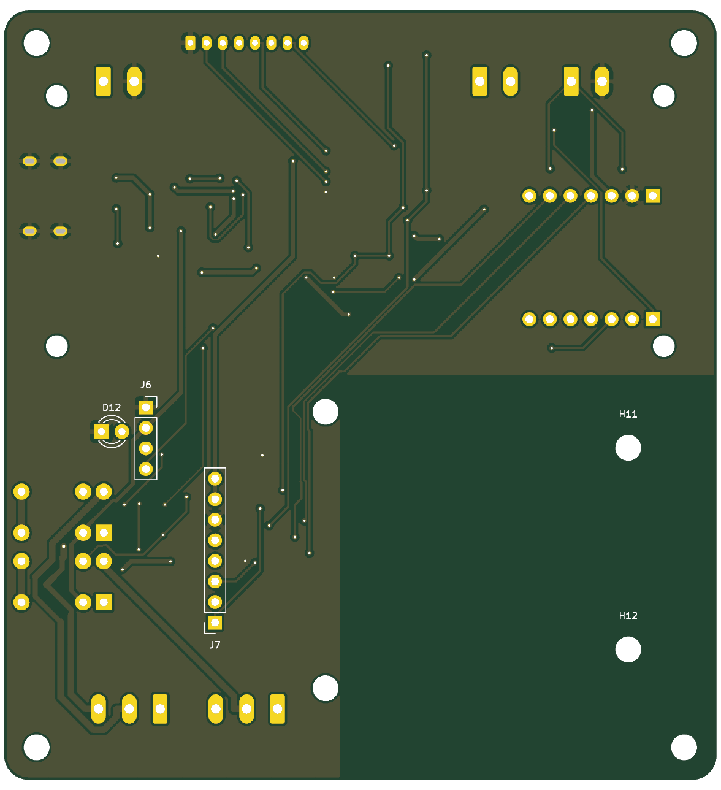
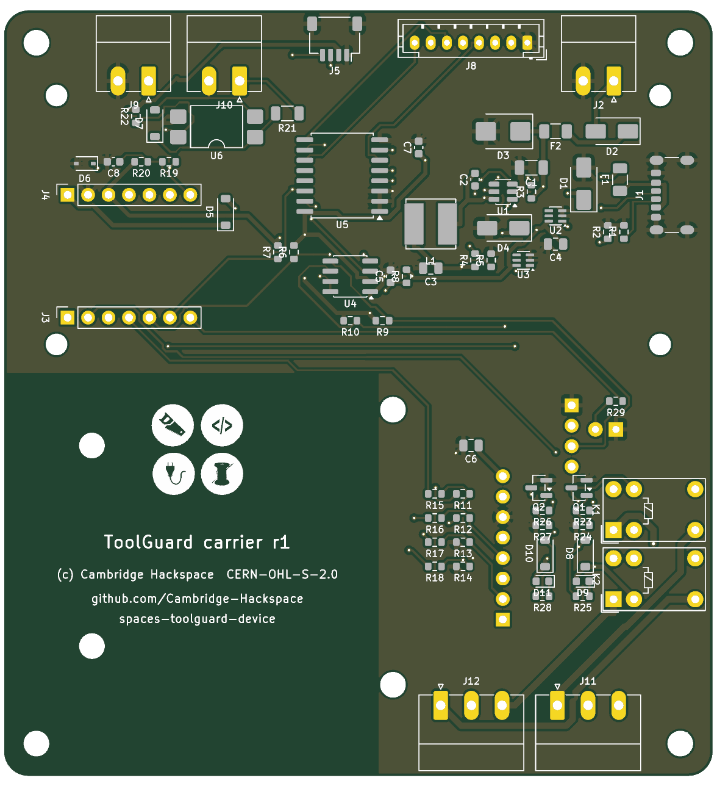
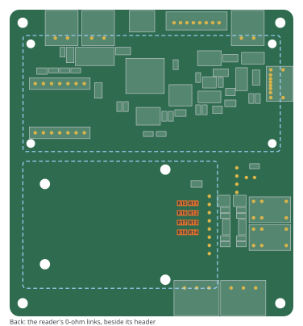
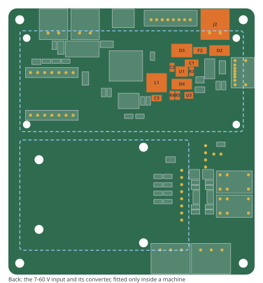
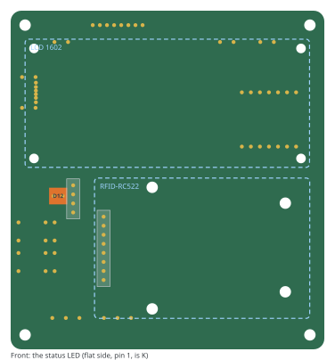
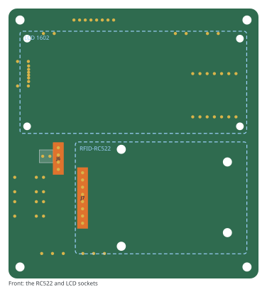
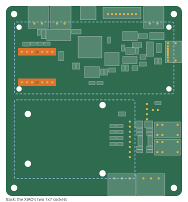
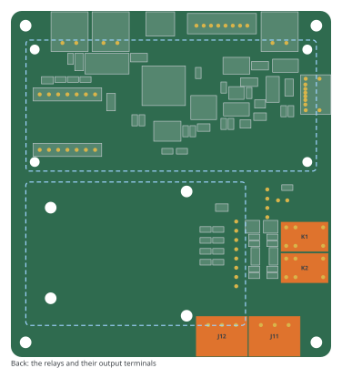
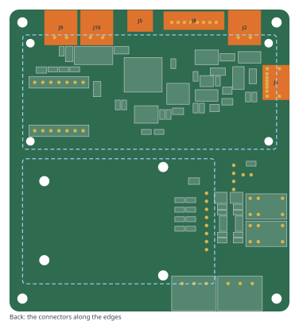
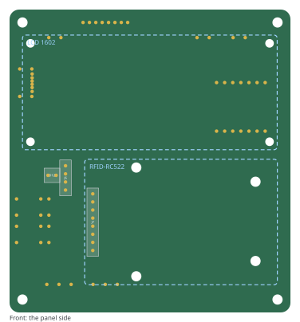

# About this board

The carrier is the ToolGuard box's board: a socketed Seeed **XIAO ESP32-C5**,
an **RFID-RC522** card reader and a **16x2 LCD** on the front, and around them
everything a box can need. One board serves every kind of box; you fit the
parts your box uses and leave the rest off.

| | Box | Fit |
|---|---|---|
| (a) | Door badge reader | reader, LCD |
| (b) | Tool badge reader, one tool | reader, LCD, stop button |
| (c) | Tool badge reader, several tools | reader, LCD, stop button, joystick |
| (d) | Usage sensor (inside a machine) | sense input, the 7-60 V input |
| (e) | Power box | relay outputs |
| (f) | Any mix | the union |

: Box configurations, from issue #24. {#tbl-configs}

::: {.callout-warning}
**This is an access-control and metering box, not a safety device.** Its stop
button ends a session through firmware, a lease and Wi-Fi; it is not an
emergency stop. Its relays are low-voltage dry contacts: **mains never comes
onto this board**. Read the firmware's
[installation guide](../../../docs/INSTALLING.md), section 1, before wiring
it to a machine.
:::

The board, as designed:

::: {#fig-board layout-ncol=2}




The board, rendered from its layout.
:::

The figures in this guide are generated from the board file
(`figures.py`), so they show the board as it is. References (R12, J7, ...) are
the ones printed on the board.

# What you need

**On the board** (assembled by the fab, surface-mount, on the back), and the
**through-hole parts you solder yourself** (@sec-solder).

**Not on the board:**

- **Seeed XIAO ESP32-C5**, with its external antenna.
- **RFID-RC522** module (the common blue board), with its 8-pin header fitted
  pointing backwards, through the board, so it plugs into the carrier.
- **16x2 LCD with a PCF8574 I²C backpack**, and a 4-wire female-female
  jumper cable from the backpack's header to the carrier.
- **Standoffs:**
  - LCD: 4 × M2.5, tall enough to clear the backpack on the back of the LCD
    (measure yours: typically 12-15 mm).
  - RC522: 4 × M3 **nylon**, the height of its header seated in the socket
    (about 11 mm). **Never metal:** metal near the antenna detunes it.
  - Enclosure: 4 × M3 at the corners.
- **Plugs for the pluggable terminals** (Phoenix Contact MC 1,5 family, 3.81 mm
  pitch): a 3-way plug per relay output, a 2-way per stop button, sense input
  or 7-60 V input you use.
- **Joystick** (box c): the 5-way module, on a JST-PH 8-way lead (PHR-8 housing).
- **Power:** a USB-C supply, 5 V at 2-3 A. Not a laptop port: see @sec-bringup.

# Before you solder

## Which reader: I²C or SPI

The RC522 sits in socket **J7** and reaches the XIAO through eight 0 Ω links,
which choose how it talks. Fit **one set of four**.

| Reader | Fit | Leave off |
|---|---|---|
| Converted to I²C (the default; see the RC522-to-I²C bench guide) | R11, R12, R13, R14 | R15, R16, R17, R18 |
| As shipped, on SPI | R15, R16, R17, R18 | R11, R12, R13, R14 |

: The reader's links. {#tbl-links}

{#fig-links width=70%}

The I²C set is fitted by the fab by default. The firmware finds the reader on
either bus at boot (I²C first), so the image is the same.

## The 7-60 V input

Boxes inside a machine take power from the machine (on a Ruida laser
controller, +24 V from CN1 or CN2 pin 6). That needs the input terminal **J2**
and its converter, which are **left off** every other box:
J2, D2, F2, D3, U1, C1, R3, C2, D4, L1, C3, R4, R5 and U3.

{#fig-vin width=70%}

USB-C and the 7-60 V input can both be connected: each feeds the board through
an ideal diode, and neither feeds back into the other.

# Soldering the through-hole parts {#sec-solder}

Lowest parts first. Everything goes on the **back** except the status LED and
the two module sockets, which go on the **front**.

1. **The status LED, D12 (front).** 3 mm. The flat side of the LED is its
   cathode, pin 1, the square pad. Leave its legs long enough to reach the
   panel's hole.

    {width=48%}

2. **The module sockets (front):** **J7**, 1×8, for the RC522, and **J6**, 1×4,
   for the LCD's cable.

    {width=48%}

3. **The XIAO's sockets, J3 and J4 (back):** two 1×7 female headers. Plug the
   XIAO into them before soldering, so they end up square and at the right
   spacing; its USB-C faces the board's edge.

    {width=48%}

4. **The relays K1, K2 and their output terminals J11, J12 (back)**, for a
   power box (e).

    {width=48%}

5. **The connectors along the edges (back):** the terminals J2 (7-60 V),
   J9 (stop) and J10 (sense) as your box needs, the joystick's JST-PH J8, the
   Qwiic port J5. The USB-C, J1, is fitted by the fab.

    {width=48%}

# Putting it together

{#fig-front width=70%}

- **The LCD** sits over the top of the front on its four M2.5 standoffs
  (holes H5-H8, 75.0 × 30.9 mm). Its backpack faces the board; run the 4-wire
  cable from the backpack's header (GND, VCC, SDA, SCL) to **J6**, pin 1 GND.
  The backpack's own pull-up resistors can stay: the board translates the bus
  to 5 V for it.
- **The RC522** plugs into **J7** at the bottom right, antenna end towards the
  board's right edge, on four **nylon** M3 standoffs (holes H9-H12).
- Set the LCD's contrast on its backpack's trimmer once the box is powered.

::: {.callout-note}
**To confirm on the first build:** that the RC522's header lines up with J7.
The header's position on the module was assumed (centred on its short edge,
2.5 mm in), not measured. If it is off, J7 moves on the board.
:::

# Wiring

All field wiring uses the pluggable terminals on the back. The details of what
to connect on a machine, and why, are in the firmware's
[installation guide](../../../docs/INSTALLING.md); in short:

| Terminal | Pins | Connect |
|---|---|---|
| J1 (USB-C) | | a 5 V, 2-3 A supply |
| J2 | VIN+, GND | 7-36 V from the machine (box d); see INSTALLING §3 |
| J9 | STOP, GND | the stop button, **normally closed**: closed at rest; pressing it, or a cut wire, stops |
| J10 | S+, S- | the sense input: S+ to a supply, S- to the signal (on the laser, L-ON1; INSTALLING §3-4) |
| J11, J12 | COM, NO, NC | a circuit the machine already has, at 30 V DC and 1 A at most: a contactor's coil, an interlock loop, a strike's own supply |

: Field wiring. {#tbl-wiring}

::: {.callout-warning}
**Never wire into the machine's own safety inputs.** On a Ruida laser
controller that is CN2 `DrProc` (the lid) and CN5 `WP1` (the water flow):
INSTALLING §3. **No mains on any terminal**: switch mains with a rated
contactor, driven by a relay output.
:::

The sense input's 2.2 kΩ resistor (R21) suits a 5 V signal; fit 10 kΩ for a
24 V one.

# Firmware

The carrier is the ESP32-C5's default board, so a C5 build is a carrier build:

```sh
MCU=esp32c5 CARGO_TARGET_DIR=target/c5 \
  cargo build --release --target riscv32imac-esp-espidf
```

Flash it over the XIAO's own USB-C (the repository's README, "Building it").
Then set the box up:

1. **Setup mode:** a new box starts in it; on a configured one, hold the XIAO's
   **BOOT** button for 3 seconds while it runs. It becomes its own Wi-Fi access
   point.
2. **The setup page:** Wi-Fi, the server, the invite, and what this box has
   (a card reader, a stop button, ...): INSTALLING §6.
3. **On the platform:** bind the device to its resource or resources in the
   roles it registered with: INSTALLING §6, "On the platform".

# Bring-up {#sec-bringup}

In this order, on the bench, before the box goes near a machine:

- [ ] **Power:** with the box running and Wi-Fi active, the XIAO's 5V pin
  reads **at least 4.45 V**. Below about 4.33 V it browns out; a weak supply
  or a laptop port is the usual cause.
- [ ] **The log** (`/log` on the box's address) shows the LCD found at its
  address, and `MFRC522 present, version 0x91` or `0x92`.
- [ ] **The LCD** shows the resting screen; set its contrast.
- [ ] **A card** reads: the log shows its number and the edge's answer.
- [ ] **Each output** clicks and its LED lights when the platform grants its
  lease; and both are off while the box boots.
- [ ] **The stop button** stops a session; disconnecting it does too.
- [ ] **The sense input** follows the machine (box d), as INSTALLING §7 describes.

When something is wrong, INSTALLING §8.

# About this guide

Copyright Cambridge Hackspace. The board's design is licensed under the CERN
Open Hardware Licence Version 2 - Strongly Reciprocal (CERN-OHL-S-2.0); its
source is at github.com/Cambridge-Hackspace/spaces-toolguard-device, under
`hardware/carrier/`.
